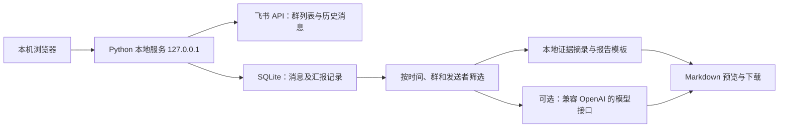

# 飞书工作汇报 Agent：最小可运行方案

状态：2026-10-21。指定内部群读取、六种报告、常用设置与一键生成已完成；本轮八项完善均已实现，详见下表。真实样本仍限 2026-10-20 当天两位发送者的 5 条消息，本人 1 条；多日复杂场景采用隔离模拟数据，不代表真实多日工作验收。默认仍为本地规则，模型验证使用模拟接口。

## 目标与范围

将指定飞书群中的消息转成可检查、可下载的日报、周报、月报，服务两种用途：个人向上工作汇报，以及项目进展汇报。先在本机手动操作，验证“能取到信息、汇报有依据、节约整理时间”这三个问题。

已确认的产品决策：

- 数据源是用户指定、且应用机器人已经加入的飞书群。
- 同时支持个人汇报与项目汇报。
- 个人汇报仅使用用户明确选择的本人发送者 ID；不将其他人的发言或提及自动归到本人名下。
- 首版在本地手动生成和下载；不定时运行，不向飞书自动发送。

这里的 Agent 是有固定输入、处理步骤和可复核输出的工作流，不需要自主执行工具的多轮框架。功能先围绕一个真实群、一个真实时间段闭环，再扩大范围。

## 架构与成本

- Python 标准库提供 HTTP 服务、JSON、SQLite、日期与网络访问；页面使用原生 HTML/CSS/JavaScript。
- 本地规则摘录是默认路径，不配置模型也能生成报告；它的质量定位是“带来源的结构化草稿”。
- 可选模型改善表达与归类，需要另配模型服务，产生该服务的调用费用，并向所配置服务发送选中消息。
- 本地运行无需购买服务器、域名、数据库或公网隧道。已有电脑与 Python 环境即可体验演示；飞书应用申请和管理员授权属于接入前置条件。
- 不引入向量库、消息队列、容器编排或通用 Agent 框架；只有实际数据量或功能证明需要时再增加。

## 数据与报告规则

1. 凭证仅由服务端从本机 `.env` 或进程环境读取；浏览器只见“已配置/未配置”，不接收 App Secret、访问令牌或模型 Key。
2. 飞书连接器以应用身份获取令牌、分页列出机器人所在群、按所选群和时间分页拉取历史消息。HTTP 成功不等同于业务成功，必须检查飞书响应错误码。
3. 消息以稳定消息 ID 保存并去重，保留群、发送者标识、发送时间、消息类型和原始来源。同步相同区间不应重复计数。
4. 文本与可提取的富文本作为汇报依据。图片、附件、语音、卡片、合并转发和话题回复不纳入首版；仅含文档链接的消息不代表已读取其文档正文。报告需说明这项覆盖边界，不将提取条数描述为群内全部消息数。
5. 演示消息与真实飞书消息按来源分开选择，不能在真实汇报中混入演示成绩。演示报告必须标识为示例。
6. 个人模式必须显式选择发送者 ID。此选择是用户声明的本人身份，不等同于系统完成飞书个人登录认证；展示可识别 ID 供用户核对。
7. 项目模式汇总选中的群。群是首版的项目边界；跨群项目可组合选择，不声称已完成自动项目识别。
8. 全部日期按 `Asia/Shanghai`（UTC+08:00）计算：日报为所选自然日，周报为所选日期所在周的周一至周日，月报为所选日期所在自然月。内部查询使用左闭右开区间；例如 10 月 19 日日报为 10 月 19 日 00:00 至 10 月 20 日 00:00 前。
9. 报告展示统计区间、选择范围、已提取消息数量、生成方式与来源证据。不能从消息最早/最晚日期推断同步完整性；尚未验证全部所选群与整个区间均已同步时，应显著提示“覆盖未核实，可能缺日或缺群”，仍可生成部分草稿。没有消息时明确显示无数据，不编造工作内容。
10. 工作进展、风险阻塞、后续计划来自源消息。报告不得把“计划完成”改写成“已经完成”，不得凭空补充比例、时间、负责人或业绩指标。个人消息中的“团队完成”也不自动改写成“我独立完成”。

## 实施顺序

| 阶段 | 交付 | 完成标准 |
| --- | --- | --- |
| A：离线闭环 | 本地页面、隔离的演示数据、三类周期、两类用途、Markdown 下载 | 无飞书凭证和模型 Key 也能运行和查看示例 |
| B：飞书读取 | 本地凭证、应用令牌、群列表、消息分页与去重、错误提示 | 模拟接口验证通过；2026-10-20 已完成指定内部群的真实消息读取 |
| C：报告质量 | 个人发送者过滤、证据引用、空数据处理、可选模型 | 其他发送者不进入个人汇报；模型故障不冒充生成成功 |
| D：交接 | README、接入说明、需求记录和验证记录 | 用户能按步骤本地配置并生成真实消息的第一份报告 |

## 首版验收

- 启动后仅监听 `127.0.0.1`，浏览器能访问控制台；未配置飞书时仍可体验演示流程。
- 用户可以选择数据来源、群、日报/周报/月报、日期、个人/项目用途，并预览和下载 Markdown。
- 个人模式只使用指定发送者的已选群内消息；不选择本人时给出可理解的提示。
- 跨周、跨月、年末以及 UTC/上海零点附近的消息划入正确区间；时间结束边界不重复。
- 飞书群与消息均完整处理分页；相同消息重复同步不会增加条数；接口失败不会显示已同步成功。
- 无权限、机器人未入群、凭证无效、网络超时等问题有明确反馈；响应不泄露密钥。
- 离线报告保留可核对的消息依据，无数据不生成虚构结论。模型输出保留来源和统计范围；同步完整性未核实时明确标记，仍需用户审核。
- 演示流程测试通过与真实飞书联调通过分开记录。无真实凭证时，不宣称已验证连接某个租户。

## 本轮八项交付与使用条件

| 项目 | 已实现的交付 | 核对口径与条件 |
| --- | --- | --- |
| 1. 成员名称与本机备注 | 飞书名称缓存、任意已同步成员备注、稳定未命名标识 | 用户确认后已新增并发布 `im:chat.members:read`，真实读取到 2 位成员名称；本人昵称优先，备注不改变本人身份与原消息 |
| 2. 工作状态分类 | 完成、进行中、风险和计划的规则完善 | 保留否定、等待验收和不明确状态，不因关键词把计划改成成果；草稿仍需审阅 |
| 3. 来源核对 | 报告生成时保存原话、作者、群与时间快照，引用编号可点开 | 后续同步与改名不改旧快照；无结构化快照的旧报告回到原有附录，不拼造历史依据 |
| 4. 人工修订 | 原稿基础上另存修订版本及说明 | 原稿保留；复制与下载对应当前版本；原始引用不能自动证明人工补充内容 |
| 5. 后台进度与恢复 | 分页、重试、生成阶段显示；后台任务防重复提交 | 有界重试短暂故障；权限错误立即提示；结果未知时继续查询进度，不从旧缓存冒充成功 |
| 6. 本地备份恢复 | SQLite 一致性备份、文件与结构校验、恢复前安全副本 | 限本机有效备份 ID，不接收任意路径；不包含 `.env`；无效备份不覆盖现库 |
| 7. 数据对账 | 所选周期逐日、逐群统计群内与本人消息及查询覆盖 | 消息数按原消息计数；区分群内与本人活跃日期；零消息不等于零工作 |
| 8. 同作者事项时间线 | 使用者手动关联同一作者的相关更新；周月报告保留周期内时间线 | 不自动跨作者归并，不删除原消息；同一事项的早期计划与后期进展保留为不同时间记录 |

日常操作与限制见 [使用说明](USAGE.md)。自动姓名读取曾因三个基础消息权限不足返回 `99991672`；用户确认唯一新增权限 `im:chat.members:read` 后已开通发布并完成真实验证。官方名称为“李成龙”和“种楠”，本人报告优先保留本机昵称“船长”；没有扩大为全通讯录访问。名称字段不保证等于群昵称。其余复杂场景的模拟检查、页面核对和真实样本结论分别记录在 [验证记录](VALIDATION.md)。

本轮自动检查命令为 `python -m unittest discover -s tests -v`；测试使用隔离临时库及模拟接口，不请求真实密钥或收费模型。最终检查结果以验证记录为准。

## 当前边界与后续条件

2026-10-22 已整理下一阶段第 9—16 项的建议优先级、执行批次及验收标准，见 [下一阶段任务规划](NEXT_PHASE_PLAN.md)。首批建议为第 9—12 项；目前仅规划，尚未确认或开始新功能实施。

飞书应用身份只访问被授权的数据，不能读取任意员工之间的私人聊天。首版不实现飞书个人 OAuth、全公司搜索、通讯录映射、云文档正文、任务、日历或多维表格读取，也不实现 OCR、附件解析、卡片与合并转发解析、话题回复补抓、多人账号隔离和互联网部署。

以下功能仍需另行安排：个人 OAuth、自动事项识别、增量同步与更完整的编辑撤回追踪、项目词典、文档与任务来源、定时生成、飞书消息或文档投递、团队部署。现有事项关联是人工确认的本机功能，不等于已接入飞书任务系统。自动投递需另行确定接收人、审核方式与权限；当前产品保持手动生成与下载。

2026-10-20 已完成专用应用创建、授权、发布、机器人入群及本机 `.env` 配置，指定内部群的真实样本已生成六种报告；详见 [验证记录](VALIDATION.md)。密钥不需要发给聊天窗口。上线到公网或多人使用前，需要单独设计身份验证、权限隔离、传输保护、审计和保留策略。
